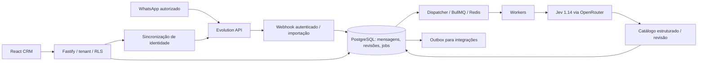

# Arquitetura

## Componentes

- `src/ingest.ts`, `normalize.ts`, `sync.ts`: normalização de conversas privadas, deduplicação, histórico retomável, edição e tombstones.
- `src/jobs.ts`, `worker.ts`: PostgreSQL como autoridade durável; Redis/BullMQ como transporte reconstruível.
- `src/analysis.ts`, `ai.ts`: decisões tipadas e validação; somente Jev 1.14 para catalogação. Uma chamada por execução contém o contexto disponível do chat, e mensagens novas podem gerar nova execução após debounce.
- `src/contact-identity.ts`: sincronização por instância, evidência explícita LID/PN, conflitos conservadores e prioridade de edição manual.
- `src/service-finance.ts`, `finance.ts`: valores contratados, recebimentos humanos/sistema autorizado, saldo e correções auditáveis.
- `src/workspace.ts`: endpoints para a interface; `src/exports.ts`: outbox com lease e confirmação.
- `web/src`: React, rotas em hash, módulos sob demanda, consulta paginada e painéis contextuais.
- `migrations`: SQL incremental; `src/db.ts` aplica contexto de tenant por transação, com papel de aplicação sem bypass de RLS.

## Garantias e limites

O histórico comercial é separado de mensagens e propostas da IA. Entregar um serviço não confirma pagamento; uma indicação de dívida não é lançamento contábil. Corrigir recebimentos preserva registros anulados. Grupos não viram leads.

A janela de 30 dias limita a catalogação inicial de novas conexões, não prova recuperação integral do histórico. Não há consolidação automática de pessoas entre contas ou fusão por nome. RLS não substitui o desenvolvimento futuro de autenticação multiusuário.

A interface não dispara reanálise apenas por abrir uma página. O worker pode chamar a IA quando há trabalho configurado e credencial disponível. Não há seleção automática de modelo substituto.
